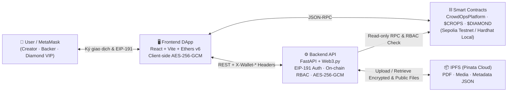

# CrowdOps — Decentralized Crowdfunding & Milestone Governance Platform

> **Môn học**: Phát triển ứng dụng Blockchain (UIT) — **Bài tập 09**  
> **Kiến trúc**: On-chain Escrow & Governance (`Solidity 0.8.24`) · Off-chain RBAC & IPFS Gateway (`FastAPI + Web3.py`) · Web3 DApp (`React + TypeScript + Ethers.js v6`)

[](https://soliditylang.org/)
[](https://hardhat.org/)
[](https://fastapi.tiangolo.com/)
[](https://vitejs.dev/)
[](https://sepolia.etherscan.io/)

---

## 1. Tổng quan & Giá trị cốt lõi

**CrowdOps** là nền tảng gọi vốn cộng đồng phi tập trung giải quyết bài toán **niềm tin** (*Code-based Trust*): thay vì chuyển toàn bộ tiền cho chủ dự án ngay khi gọi vốn thành công, toàn bộ ETH được khóa trong **Escrow Vault** on-chain và chỉ được giải ngân từng phần (*Milestone*) khi có **trên 50% trọng số phiếu tán thành** từ các Backer.

### Kiến trúc hệ thống



---

## 2. Đối chiếu Yêu cầu Học thuật (4/4 Tiêu chí)

| Tiêu chí | Hiện thực trong CrowdOps | Thành phần chính |
| :--- | :--- | :--- |
| **1. Smart Contract & Bảo mật** | • **Nghiệp vụ**: `createCampaign()`, `contribute()`, `refund()`, `requestSpending()`, `approveRequest()`, `finalizeSpending()`.<br/>• **Ràng buộc & Bảo mật**: `ReentrancyGuard`, mô hình *Checks-Effects-Interactions*, `onlyCreator`, kiểm tra hạn chót (`CampaignDeadlinePassed`), ngưỡng tán thành `> 50%` (`ApprovalThresholdNotMet`).<br/>• **Testnet**: Đã deploy và verify trên **Sepolia**; **35/35** Hardhat unit/integration tests pass. | `contracts/core/CrowdOpsPlatform.sol`<br/>`contracts/core/ICrowdOps.sol`<br/>`test/*.test.ts` |
| **2. Web3.py & Frontend DApp** | • **On-chain UI**: Kết nối MetaMask, tạo chiến dịch, đóng góp ETH, hoàn tiền 100%, bỏ phiếu & giải ngân Milestone, xem trạng thái real-time.<br/>• **Backend Web3.py**: Đọc trạng thái chiến dịch, biểu quyết, số dư token và xác thực chữ ký ví **EIP-191** (`/auth/challenge`, `/auth/roles`).<br/>• **Mã hóa**: **AES-256-GCM** cho ghi chú nhạy cảm (Frontend) và file Proof/Exclusive (Backend). | `frontend/src/App.tsx`<br/>`frontend/src/utils/crypto.ts`<br/>`backend/app/shared/web3_provider.py`<br/>`backend/app/modules/auth/` |
| **3. Tích hợp IPFS & RBAC** | • **≥ 3 loại dữ liệu**: PDF (Proposal / Hóa đơn Proof), Media (Ảnh / Video), Metadata JSON.<br/>• **≥ 2 thao tác**: Upload lên Pinata và Retrieve qua `GET /ipfs/files/{cid}`.<br/>• **RBAC On-chain**: Kiểm tra vai trò `public` / `backer` / `creator` / `diamond` trực tiếp từ Smart Contract trước khi giải mã và trả file. | `backend/app/modules/ipfs/`<br/>`backend/app/shared/file_crypto.py`<br/>`backend/tests/test_rbac.py` |
| **4. Token ERC-20 & NFT** | • **ERC-20 (`$CROPS`)**: `GovernanceToken` tự động mint `1 ETH = 1,000 $CROPS` khi đóng góp (`onlyPlatform`).<br/>• **ERC-721 (`$DIAMOND`)**: `DiamondPatronNFT` tự động mint huy hiệu VIP khi đạt ngưỡng đóng góp.<br/>• **Nghiệp vụ**: Cấp (`mint`, `mintDiamondBadge`), Chuyển (`transfer`, `transferFrom`), Xác thực (`balanceOf`, `ownerOf`, `verifyDiamondPatron`). | `contracts/tokens/GovernanceToken.sol`<br/>`contracts/tokens/DiamondPatronNFT.sol`<br/>`test/Tokenomics.test.ts` |

---

## 3. Địa chỉ Smart Contracts đã Deploy (Sepolia Testnet)

Tất cả 3 hợp đồng đã được triển khai và **Verify mã nguồn** trên Sepolia Etherscan (`chainId: 11155111`):

| Contract | Địa chỉ (Sepolia) | Etherscan |
| :--- | :--- | :--- |
| **CrowdOpsPlatform** | `0x522a90676C43b8EDEf460235CEa0bAa4Ae5bb35f` | [Xem trên Etherscan](https://sepolia.etherscan.io/address/0x522a90676C43b8EDEf460235CEa0bAa4Ae5bb35f#code) |
| **GovernanceToken (`$CROPS`)** | `0x7D921748E55cdc2A0120551F4bdFE6A57bcBf883` | [Xem trên Etherscan](https://sepolia.etherscan.io/address/0x7D921748E55cdc2A0120551F4bdFE6A57bcBf883#code) |
| **DiamondPatronNFT (`$DIAMOND`)** | `0x9B5EbC653EFD26c232a3061c1CeC9A72718Dc2EF` | [Xem trên Etherscan](https://sepolia.etherscan.io/address/0x9B5EbC653EFD26c232a3061c1CeC9A72718Dc2EF#code) |

> **Deployer**: `0xcB8f1B2CCa044bd1e7539eE2461Eadd914750CCC` (Cấu hình lưu tại [addresses.json](frontend/src/contracts/addresses.json)).

---

## 4. Cấu trúc thư mục

```text
Crowdfunding/
├── contracts/
│   ├── core/               # ICrowdOps.sol, CrowdOpsPlatform.sol (Escrow & Governance)
│   └── tokens/             # GovernanceToken.sol ($CROPS), DiamondPatronNFT.sol ($DIAMOND), sample metadata
├── scripts/
│   ├── deploy.ts           # Deploy 3 contracts, liên kết quyền & export ABI sang frontend/
│   └── verify.ts           # Verify contracts trên Sepolia Etherscan
├── test/                   # Bộ test Hardhat TypeScript (CrowdOps.test.ts, CrowdOpsPlatform.test.ts, Tokenomics.test.ts)
├── backend/
│   ├── app/
│   │   ├── core/           # Custom Exception Handlers
│   │   ├── shared/         # Web3Provider, ContractLoader, AES-256-GCM FileCrypto
│   │   └── modules/        # auth (EIP-191 + RBAC), campaign, voting, ipfs (Pinata), tokenomics
│   ├── abis/               # ABI JSON cho Web3.py
│   └── tests/              # Pytest unit, RBAC & integration tests
├── frontend/
│   └── src/
│       ├── contracts/      # ABI JSON & addresses.json (31337 Local + 11155111 Sepolia)
│       ├── utils/          # web3.ts (Ethers v6), api.ts (Backend + EIP-191), crypto.ts (AES-256-GCM)
│       └── App.tsx         # Giao diện DApp hoàn chỉnh
└── .github/workflows/      # CI Pipeline (Smart Contracts, Python Backend, Frontend Build)
```

---

## 5. Hướng dẫn Cài đặt, Chạy & Demo

### Yêu cầu môi trường
- **Node.js** `>= 20.x` và `npm`
- **Python** `3.11+`
- **MetaMask** extension trên trình duyệt
- *(Tùy chọn cho IPFS & Sepolia)*: Tài khoản **Pinata** (`PINATA_JWT`) và **Sepolia RPC** (Alchemy/Infura)

---

### Cách 1: Chạy Full Stack trên máy Local (Hardhat Node + Backend + Frontend)

#### Bước 1: Cài đặt dependencies
```bash
# 1. Smart Contracts (tại thư mục gốc)
npm ci

# 2. Backend Python
python3 -m venv backend/.venv
backend/.venv/bin/python -m pip install -r backend/requirements.lock
cp -n backend/.env.example backend/.env

# 3. Frontend
cd frontend && npm ci && cd ..
```

#### Bước 2: Khởi động Blockchain Local (Terminal 1)
```bash
npm run node
```
*(Hardhat sẽ tạo 20 ví test tại `http://127.0.0.1:8545`, `Chain ID: 31337`)*

#### Bước 3: Deploy Smart Contracts & lấy địa chỉ (Terminal 2)
```bash
npm run deploy:local
```
Copy 3 địa chỉ in ra (`CrowdOpsPlatform`, `GovernanceToken`, `DiamondPatronNFT`) điền vào `backend/.env`:
```env
RPC_URL=http://127.0.0.1:8545
CHAIN_ID=31337
PLATFORM_ADDRESS=0x...
GOVERNANCE_TOKEN_ADDRESS=0x...
DIAMOND_NFT_ADDRESS=0x...
PINATA_JWT=<your_pinata_jwt>
FILE_ENCRYPTION_KEY=<base64_32_byte_key>
```
> Tạo nhanh `FILE_ENCRYPTION_KEY`:
> ```bash
> python3 -c "import base64,os; print(base64.b64encode(os.urandom(32)).decode())"
> ```

#### Bước 4: Khởi động Backend FastAPI (Terminal 2)
```bash
cd backend
.venv/bin/uvicorn app.main:app --host 127.0.0.1 --port 8000 --reload
```
- Kiểm tra API Docs (Swagger UI): **http://127.0.0.1:8000/docs**
- Health check: `curl http://127.0.0.1:8000/health/rpc`

#### Bước 5: Khởi động Frontend DApp (Terminal 3)
```bash
cd frontend
npm run dev
```
- Mở trình duyệt tại: **http://localhost:5173**
- Thêm mạng **Localhost 8545** (`Chain ID: 31337`) vào MetaMask và import 1–2 private key test từ Terminal 1.

---

### Cách 2: Demo trực tiếp trên Sepolia Testnet
Không cần chạy `npx hardhat node` hay deploy lại; chỉ cần trỏ `backend/.env` về Sepolia:
```env
RPC_URL=https://eth-sepolia.g.alchemy.com/v2/<YOUR_KEY>
CHAIN_ID=11155111
PLATFORM_ADDRESS=0x522a90676C43b8EDEf460235CEa0bAa4Ae5bb35f
GOVERNANCE_TOKEN_ADDRESS=0x7D921748E55cdc2A0120551F4bdFE6A57bcBf883
DIAMOND_NFT_ADDRESS=0x9B5EbC653EFD26c232a3061c1CeC9A72718Dc2EF
PINATA_JWT=<your_pinata_jwt>
FILE_ENCRYPTION_KEY=<base64_32_byte_key>
```
Sau đó chạy **Backend** (Bước 4) và **Frontend** (Bước 5), chuyển MetaMask sang mạng **Sepolia**.

---

## 6. Kịch bản Demo 6 bước (End-to-End Flow)

1. **Kết nối ví**: Bấm **Kết nối MetaMask** trên DApp — hệ thống tự hiển thị `Chain ID`, số dư `ETH`, `$CROPS` và huy hiệu **Diamond VIP**.
2. **Tạo chiến dịch (`createCampaign`)**: Upload file **Proposal PDF**, **Media (ảnh/video)**, **Metadata JSON** lên IPFS (kèm tùy chọn mã hóa **AES-256-GCM** thông tin liên hệ nhạy cảm) → ký giao dịch on-chain.
3. **Đóng góp & Nhận Token/NFT (`contribute`)**: Đóng góp ETH bằng ví Backer → hợp đồng tự động mint `$CROPS` (`1 ETH = 1,000 CROPS`) và cấp **Diamond Patron NFT** khi đạt ngưỡng.
4. **Kiểm chứng RBAC trên IPFS**: Chuyển đổi giữa ví `public`, `backer`, `creator` và `diamond` để truy xuất tài liệu **Proof** / **Exclusive** qua `GET /ipfs/files/{cid}` — chỉ ví đủ quyền on-chain mới được Backend giải mã AES-256-GCM và trả file.
5. **Quản trị Milestone (`requestSpending` → `approveRequest` → `finalizeSpending`)**: Creator upload hóa đơn Proof PDF (mã hóa) → Backer bỏ phiếu `Approve` (`> 50%` tổng vốn) → giải ngân ETH cho người nhận.
6. **Hoàn tiền tự động (`refund`)**: Với chiến dịch hết hạn mà chưa đạt Goal, Backer gọi `refund()` để rút lại **100% ETH** (bảo vệ bằng `ReentrancyGuard`).

---

## 7. Kiểm thử tự động (Automated Tests)

```bash
# Smart Contracts (Hardhat — 35/35 test cases)
npx hardhat test

# Frontend Production Build (TypeScript + Vite)
cd frontend && npm run build

# Backend API, RBAC & Crypto Tests (Pytest)
cd backend && .venv/bin/pytest
```
