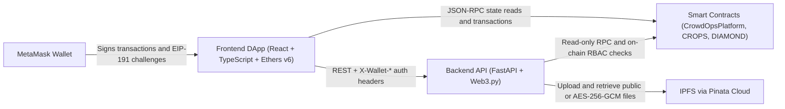

# CrowdOps

Decentralized crowdfunding and milestone-governed escrow platform built with Solidity, FastAPI (`web3.py`), React (`ethers` v6), and IPFS (Pinata).

CrowdOps replaces unilateral creator custody with on-chain escrow: contributed ETH remains locked in `CrowdOpsPlatform` and is disbursed per milestone only after backers holding strictly more than 50% of total raised weight vote to approve the submitted proof.

---

## System Architecture



### Design Invariants

- **On-chain Escrow and Reentrancy Safety**: `CrowdOpsPlatform` inherits OpenZeppelin `ReentrancyGuard` and `Ownable`, enforcing Checks-Effects-Interactions on both `refund()` and `finalizeSpending()`.
- **Weighted Milestone Governance**: Backer voting power equals their ETH contribution. A spending request is disbursed only when `approvalWeight * 2 > totalFundsRaised`, and is permanently locked (`rejected = true`) if `rejectWeight * 2 >= totalFundsRaised`.
- **Automated Tokenomics**: On every `contribute()` call, `CrowdOpsPlatform` mints `CROPS` (`GovernanceToken`, ERC-20) at `1 ETH = 1,000 CROPS` and mints a `DIAMOND` badge (`DiamondPatronNFT`, ERC-721) once a backer's cumulative contribution reaches `diamondTierThreshold` (default `1 ETH`, configurable by owner for testnet demos).
- **On-chain RBAC and Encryption**: Protected IPFS assets (`proof` invoices and `exclusive` Diamond content) are encrypted with AES-256-GCM prior to pinning. `GET /ipfs/files/{cid}` verifies EIP-191 wallet signatures and queries live on-chain roles (`public`, `backer`, `creator`, `diamond`) before decrypting and streaming the file. Client-side AES-256-GCM is also provided for sensitive campaign notes.

---

## Deployed Contracts (Sepolia Testnet)

All contracts are deployed and source-verified on Sepolia (`chainId: 11155111`) and recorded in [frontend/src/contracts/addresses.json](frontend/src/contracts/addresses.json):

| Contract | Address | Explorer |
| :--- | :--- | :--- |
| `CrowdOpsPlatform` | `0x522a90676C43b8EDEf460235CEa0bAa4Ae5bb35f` | [Sepolia Etherscan](https://sepolia.etherscan.io/address/0x522a90676C43b8EDEf460235CEa0bAa4Ae5bb35f#code) |
| `GovernanceToken` (`CROPS`) | `0x7D921748E55cdc2A0120551F4bdFE6A57bcBf883` | [Sepolia Etherscan](https://sepolia.etherscan.io/address/0x7D921748E55cdc2A0120551F4bdFE6A57bcBf883#code) |
| `DiamondPatronNFT` (`DIAMOND`) | `0x9B5EbC653EFD26c232a3061c1CeC9A72718Dc2EF` | [Sepolia Etherscan](https://sepolia.etherscan.io/address/0x9B5EbC653EFD26c232a3061c1CeC9A72718Dc2EF#code) |

Deployer: `0xcB8f1B2CCa044bd1e7539eE2461Eadd914750CCC`

---

## Repository Structure

```text
.
├── contracts/
│   ├── core/
│   │   ├── ICrowdOps.sol              # Interface, enums, structs, custom errors, events
│   │   └── CrowdOpsPlatform.sol       # Escrow vault, fundraising, refunds, milestone voting
│   └── tokens/
│       ├── IGovernanceToken.sol
│       ├── GovernanceToken.sol        # ERC-20 ($CROPS), platform-only minting
│       ├── IDiamondPatronNFT.sol
│       ├── DiamondPatronNFT.sol       # ERC-721 ($DIAMOND) with URI storage & mint timestamp
│       └── metadata/                  # Sample ERC-721 metadata JSON
├── scripts/
│   ├── deploy.ts                      # Deploy, link contracts, export ABIs & addresses
│   └── verify.ts                      # Etherscan verification script
├── test/
│   ├── CrowdOpsPlatform.test.ts       # Core fundraising, refund, and milestone unit tests
│   ├── CrowdOps.test.ts               # End-to-end integration scenarios
│   └── Tokenomics.test.ts             # ERC-20/ERC-721 minting, access control, transfers
├── backend/
│   ├── app/
│   │   ├── core/errors.py             # Structured ServiceError and validation handlers
│   │   ├── shared/                    # Web3Provider, ContractLoader, AES-256-GCM FileCrypto
│   │   └── modules/                   # auth, campaign, voting, ipfs, tokenomics
│   ├── abis/                          # Contract ABIs for Web3.py
│   └── tests/                         # Pytest suite (API, RBAC, crypto, integration)
├── frontend/
│   └── src/
│       ├── contracts/                 # Exported ABIs and chain address registry
│       ├── components/IpfsViewers.tsx # Public media renderer & RBAC-protected file viewer
│       ├── utils/                     # web3.ts (Ethers v6), api.ts (EIP-191), crypto.ts (AES-GCM)
│       └── App.tsx                    # Main DApp interface
└── .github/workflows/ci.yml           # CI pipeline for contracts, backend, and frontend
```

---

## Getting Started

### Prerequisites

- Node.js 20+ and npm
- Python 3.11+
- MetaMask browser extension
- Pinata JWT (`PINATA_JWT`) for live IPFS uploads, and a Sepolia RPC URL if running against testnet

### 1. Install Dependencies

```bash
# Root (Hardhat & Smart Contracts)
npm ci

# Backend (Python virtual environment)
python3 -m venv backend/.venv
backend/.venv/bin/python -m pip install -r backend/requirements.lock
cp -n backend/.env.example backend/.env

# Frontend (React + Vite)
cd frontend && npm ci && cd ..
```

### 2. Run Locally (Hardhat Node + Backend + Frontend)

Start a local Hardhat node in Terminal 1:

```bash
npm run node
```

Deploy and link the contracts in Terminal 2:

```bash
npm run deploy:local
```

Generate a 32-byte AES-256 key and configure `backend/.env` with the printed contract addresses:

```bash
python3 -c "import base64,os; print(base64.b64encode(os.urandom(32)).decode())"
```

```env
RPC_URL=http://127.0.0.1:8545
CHAIN_ID=31337
PLATFORM_ADDRESS=<deployed_CrowdOpsPlatform_address>
GOVERNANCE_TOKEN_ADDRESS=<deployed_GovernanceToken_address>
DIAMOND_NFT_ADDRESS=<deployed_DiamondPatronNFT_address>
PINATA_JWT=<your_pinata_jwt>
FILE_ENCRYPTION_KEY=<generated_base64_key>
```

Start the FastAPI backend in Terminal 2:

```bash
cd backend
.venv/bin/uvicorn app.main:app --host 127.0.0.1 --port 8000 --reload
```

Start the Vite frontend in Terminal 3:

```bash
cd frontend
npm run dev
```

- Frontend DApp: `http://localhost:5173`
- Backend Swagger UI: `http://127.0.0.1:8000/docs`
- Backend Health Check: `http://127.0.0.1:8000/health/rpc`

### 3. Run Against Sepolia Testnet

Skip `npm run node` and `npm run deploy:local`. Point `backend/.env` to Sepolia (`CHAIN_ID=11155111`) using the verified addresses listed in the [Deployed Contracts](#deployed-contracts-sepolia-testnet) table above, start the backend and frontend, and switch MetaMask to Sepolia.

To redeploy your own instance to Sepolia:

```bash
cp -n .env.example .env
# Populate SEPOLIA_RPC_URL, DEPLOYER_PRIVATE_KEY, ETHERSCAN_API_KEY
npm run deploy:sepolia
npm run verify:sepolia
```

---

## API Reference (Backend)

| Endpoint | Auth | Description |
| :--- | :--- | :--- |
| `GET /health`, `GET /health/rpc` | Public | Liveness and RPC chain ID verification |
| `GET /auth/challenge?address=` | Public | Issues an EIP-191 challenge message for wallet signing |
| `GET /auth/roles?campaign_id=` | Wallet Signature | Resolves live on-chain roles (`public`, `backer`, `creator`, `diamond`) |
| `GET /campaigns`, `GET /campaigns/{id}` | Public | Reads campaign state, progress, and stats via `web3.py` |
| `GET /campaigns/{id}/requests` | Public | Lists milestone spending requests and vote weights |
| `GET /tokenomics/tier/{address}` | Public | Queries `CROPS` and `DIAMOND` balances and returns tier status |
| `POST /ipfs/upload`, `POST /ipfs/metadata` | Wallet Signature | Uploads PDF, media, or JSON metadata to Pinata (AES-256-GCM for `proof`/`exclusive`) |
| `GET /ipfs/files/{cid}` | Wallet Signature + RBAC | Verifies on-chain role, decrypts if protected, and streams the file |

---

## Testing

```bash
# Smart contracts (35 unit and integration tests)
npx hardhat test

# Frontend TypeScript check and production bundle
cd frontend && npm run build

# Backend unit, RBAC, and encryption tests
cd backend && .venv/bin/pytest
```
